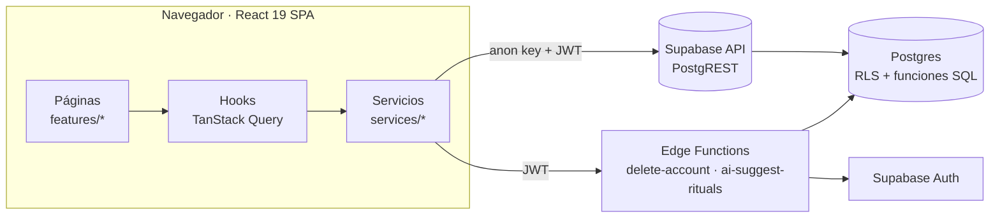

<div align="center">


# RitualKiller

**La disciplina no se promete. Se ritualiza.**

Aplicación web _mobile-first_ para convertir hábitos en rituales medibles: rachas, esencia, rangos, objetivos, logros y una comunidad que sostiene la constancia.

[](https://github.com/n3brrr/RitualKiller/actions/workflows/ci.yml)


[Demo](https://ritualkiller.vercel.app/) · [Informar de un problema](https://github.com/n3brrr/RitualKiller/issues) · [Auditoría del proyecto](features.md)

</div>

---

## Índice

- [Descripción](#descripción)
- [Funcionalidades](#funcionalidades)
- [Arquitectura](#arquitectura)
- [Puesta en marcha](#puesta-en-marcha)
- [Configuración de Supabase](#configuración-de-supabase)
- [Scripts](#scripts)
- [Calidad y tests](#calidad-y-tests)
- [Despliegue](#despliegue)
- [Seguridad](#seguridad)
- [Estructura del proyecto](#estructura-del-proyecto)
- [Contribuir](#contribuir)
- [Autores](#autores)

## Descripción

RitualKiller es una SPA en React y TypeScript que usa Supabase como backend (autenticación, Postgres, autorización con RLS y Edge Functions). No hay servidor propio: toda la lógica sensible —recompensas, rachas, logros, efectos de objetos, moderación— vive en funciones SQL del servidor, de modo que el cliente nunca decide valores que afecten a la economía del juego.

La interfaz está disponible en **español e inglés**, se adapta a móvil y escritorio y sigue pautas de accesibilidad WCAG 2.1 AA.

## Funcionalidades

| Área                 | Qué ofrece                                                                                                                                        |
| -------------------- | ------------------------------------------------------------------------------------------------------------------------------------------------- |
| **Rituales**         | Rituales diarios o semanales, creación manual o desde una biblioteca de plantillas, edición y archivado sin perder el historial.                  |
| **Rachas y esencia** | Rachas calculadas desde el historial en la zona horaria del usuario (hoy o ayer), bonus por continuidad, esencia acumulada y rangos.              |
| **Objetivos**        | Metas vinculadas a rituales con progreso calculado automáticamente entre su creación y la fecha objetivo.                                         |
| **Logros**           | Trece logros evaluados y concedidos por el servidor, con notificaciones in-app.                                                                   |
| **Mercado**          | Objetos consumibles (elixir de esencia, poción que protege la racha) y permanentes (amuleto cosmético, contrato que desbloquea rituales maestro). |
| **Comunidad**        | Feed paginado (todos / siguiendo), likes, comentarios, seguimiento, perfiles públicos y reportes.                                                 |
| **Analíticas**       | Heatmap anual, calendario mensual, métricas de productividad y gráficos de 7/30/90 días con alternativa textual accesible.                        |
| **Datos**            | Exportación JSON/CSV del historial completo e importación transaccional e idempotente de copias de seguridad.                                     |
| **Administración**   | Métricas globales, moderación de reportes con contexto, borrado auditado de contenido, suspensiones temporales y registro de errores.             |
| **Cuenta**           | Registro, recuperación de contraseña, cambio de contraseña con reautenticación y eliminación completa de la cuenta.                               |

## Arquitectura



- **Capas del cliente:** `features/<dominio>/pages` → `hooks/use*` (caché, invalidaciones y actualizaciones optimistas) → `services/*Service` (único punto que habla con Supabase y transforma filas en tipos de `src/types`).
- **Lógica en el servidor:** las tablas que afectan a la economía (`inventory`, `active_buffs`, `ritual_logs`, `user_achievements`, `notifications`) solo se escriben mediante funciones `SECURITY DEFINER` como `complete_ritual`, `purchase_item`, `consume_item`, `save_goal` o `import_backup`.
- **Vistas de lectura:** `rituals_with_streak`, `goals_with_progress`, `public_profiles` y `report_details` exponen datos calculados sin duplicar lógica en el cliente.
- **i18n:** diccionarios tipados (`src/i18n/es.ts` es la fuente de las claves) con interpolación y plurales.

## Puesta en marcha

### Requisitos

- Node.js 22 o superior
- [pnpm](https://pnpm.io/) 12 (único gestor soportado)
- Un proyecto de [Supabase](https://supabase.com/) y, para las funciones, la [Supabase CLI](https://supabase.com/docs/guides/cli)
- Docker (opcional, solo para el despliegue en contenedor)

### Instalación

```bash
git clone https://github.com/n3brrr/RitualKiller.git
cd RitualKiller
pnpm install
cp .env.example .env
```

Rellena `.env`:

| Variable                 | Obligatoria | Descripción                                                                |
| ------------------------ | ----------- | -------------------------------------------------------------------------- |
| `VITE_SUPABASE_URL`      | Sí          | URL del proyecto de Supabase.                                              |
| `VITE_SUPABASE_ANON_KEY` | Sí          | Clave pública (`anon`). La autorización real la aplican RLS y el servidor. |
| `VITE_AI_ENABLED`        | No          | `true` solo cuando la Edge Function de IA tenga un proveedor configurado.  |

Prepara la base de datos (ver la sección siguiente) y arranca el entorno de desarrollo:

```bash
pnpm dev   # http://localhost:3000
```

## Configuración de Supabase

1. **Migraciones:** aplica todos los archivos de `supabase/migrations/` en orden (`supabase db push` o el SQL Editor).
2. **Edge Functions:**
   ```bash
   supabase functions deploy delete-account        # necesaria para eliminar cuentas
   supabase functions deploy ai-suggest-rituals    # opcional (punto de extensión de IA)
   ```
3. **Auth (panel de Supabase):** longitud mínima de contraseña 8, _Leaked password protection_ y _Secure password change_ activados, y las URLs `https://<dominio>/auth/callback` y `https://<dominio>/reset-password` en las redirecciones permitidas.
4. **Primer administrador:**
   ```sql
   update public.profiles set is_admin = true where username = 'tu_usuario';
   ```

El detalle de cada migración y de las funciones está en [`supabase/README.md`](supabase/README.md).

## Scripts

| Comando          | Descripción                                                                   |
| ---------------- | ----------------------------------------------------------------------------- |
| `pnpm dev`       | Servidor de desarrollo de Vite en `localhost:3000`.                           |
| `pnpm build`     | Build de producción en `dist/`.                                               |
| `pnpm preview`   | Sirve el build localmente.                                                    |
| `pnpm typecheck` | Comprobación de tipos con `tsc --noEmit`.                                     |
| `pnpm lint`      | ESLint (incluye reglas de accesibilidad `jsx-a11y` y de React).               |
| `pnpm format`    | Formatea el repositorio con Prettier (`format:check` solo lo comprueba).      |
| `pnpm test`      | Tests del cliente con Vitest y Testing Library.                               |
| `pnpm test:db`   | Tests de migraciones, RLS y funciones SQL sobre Postgres en memoria (PGlite). |
| `pnpm analyze`   | Genera el informe del bundle en `reports/` (no se publica).                   |
| `pnpm verify`    | Ejecuta todo lo anterior, como la integración continua.                       |

## Calidad y tests

- **Integración continua** (GitHub Actions): formato, tipos, lint, tests del cliente, tests de base de datos y build en cada push y pull request.
- **Tests de base de datos sin Docker:** `pnpm test:db` aplica todas las migraciones sobre [PGlite](https://pglite.dev/) con un _stub_ mínimo de Supabase y ejecuta las pruebas como los roles `anon` y `authenticated`. Reproducen los ataques conocidos (inventario o ventajas forjadas, logros autoconcedidos, fechas arbitrarias, publicaciones de sistema falsas…) y verifican que se rechazan.
- **Tests del cliente:** utilidades de fechas y analítica, validación, exportación/importación, mapeo de errores, coherencia de los diccionarios de i18n y servicios.
- **Accesibilidad:** etiquetas en todos los formularios, contraste AA, regiones _live_ para avisos, tablas alternativas a los gráficos y objetivos táctiles de 44 px.

## Despliegue

### Vercel

`vercel.json` configura el _fallback_ de la SPA, cabeceras de seguridad (CSP, HSTS, Permissions-Policy) y caché: `index.html` sin caché y `/assets/*` inmutable durante un año. Define `VITE_SUPABASE_URL` y `VITE_SUPABASE_ANON_KEY` en el proyecto.

### Docker

```bash
docker compose up --build   # http://localhost:8080
```

La imagen compila la app con Node 22 y la sirve con **nginx sin privilegios de root** (puerto 8080), sistema de ficheros de solo lectura, `HEALTHCHECK` en `/healthz` y las mismas cabeceras de seguridad que Vercel.

> Si usas un dominio propio para Supabase, añádelo a `connect-src` en `docker/security-headers.conf` y en `vercel.json`.

## Seguridad

- **RLS en todas las tablas** y escrituras sensibles únicamente a través de funciones del servidor que validan `auth.uid()`.
- **Valores calculados en el servidor:** recompensas, fechas válidas (hoy o ayer en la zona horaria del usuario), rachas, logros y efectos de objetos.
- **Privacidad:** los perfiles ajenos se leen desde `public_profiles`, sin datos privados; los avatares solo admiten `https` y se cargan sin _referrer_.
- **Abuso:** límites de frecuencia en publicaciones, comentarios, reportes y seguimientos, reportes únicos por objetivo y suspensiones auditadas.
- **Cuenta:** contraseña mínima de 8 caracteres, reautenticación para cambiarla y eliminación completa (Auth y datos en cascada).
- **Superficie mínima:** funciones no ejecutables por usuarios anónimos salvo concesión explícita, ninguna clave privada en el bundle y la IA solo a través de una Edge Function autenticada con cuota.
- **Observabilidad:** errores del cliente en `error_logs` con límites de tamaño y frecuencia y sin datos personales.

¿Has encontrado una vulnerabilidad? Escribe a los autores en privado en lugar de abrir una incidencia pública.

## Estructura del proyecto

```text
RitualKiller/
├── src/
│   ├── components/        # UI compartida (ui/, layout/, rituales, social, analíticas…)
│   ├── features/          # Páginas por dominio (auth, rituals, goals, social, admin…)
│   ├── hooks/             # Hooks de datos (TanStack Query) y de UI
│   ├── services/          # Acceso a Supabase y punto de extensión de IA
│   ├── lib/               # Cliente Supabase, errores, observabilidad, utilidades de carga
│   ├── i18n/              # Diccionarios ES/EN, proveedor y helpers
│   ├── data/              # Contenido estático (logros, biblioteca, iconos, citas)
│   ├── utils/             # Fechas, analítica, validación, exportación/importación
│   └── types/             # Tipos compartidos
├── supabase/
│   ├── migrations/        # Esquema, RLS y funciones SQL (orden por fecha)
│   ├── functions/         # Edge Functions (Deno)
│   └── tests/             # Tests de base de datos con PGlite
├── docker/                # nginx y cabeceras de seguridad
├── public/                # Recursos estáticos
├── features.md            # Informe de auditoría y estado de cada hallazgo
└── .github/workflows/     # Integración continua
```

## Contribuir

1. Crea una rama desde `master` (`feat/...`, `fix/...`).
2. Sigue la arquitectura por capas: la lógica que afecte a datos o seguridad va en una **nueva migración** con su test en `supabase/tests/`.
3. Todo texto visible pasa por i18n (`t` / `tn`) en ambos idiomas.
4. Usa [Conventional Commits](https://www.conventionalcommits.org/) con ámbito, por ejemplo `fix(social): ...`.
5. Ejecuta `pnpm verify` antes de abrir la pull request.

## Autores

Proyecto de Trabajo de Fin de Grado desarrollado por:

- **Rubén Torres** — [@n3brrr](https://github.com/n3brrr)
- **Jesús Domínguez** — [@JesusDI04](https://github.com/JesusDI04)

<div align="center">

Si el proyecto te resulta útil, deja una ⭐ en el repositorio.

</div>
